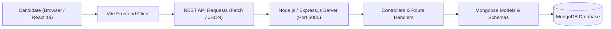

# 🚀 Tamasha Candidate Onboarding Portal — Full-Stack MERN Application

A responsive candidate onboarding and recruitment management platform built with **React, Node.js, Express.js, and MongoDB** to streamline employee verification, document submissions, and administrative reviews.

---

## 📌 Project Overview

The **Tamasha Candidate Onboarding Portal** is designed to eliminate paperwork and delays in onboarding new hires. It provides candidates with a guided, multi-step profile submission workflow while equipping HR administrators with an interface to review candidate information, track verification stages, and manage documentation.

### Core Objectives:
- **Guided Candidate Onboarding:** Multi-step wizard covering personal details, academic history, professional experience, and identity document uploads.
- **RESTful API Backend:** Modular Express.js and Node.js architecture with clean route controllers and MongoDB schema models.
- **State Management & Form Validation:** Real-time client-side form verification in React paired with schema validation in Mongoose.
- **Clean Architecture:** Separation of concerns between frontend client (`src/`) and backend services (`backend/`).

---

## 🏗️ System Architecture & Workflow



---

## 📂 Repository Structure

```text
Tamasha_Onborading-/
├── backend/
│   ├── config/           # Database connection configuration (db.js)
│   ├── controllers/      # Request handlers and business logic
│   ├── models/           # Mongoose schemas (Candidate, Onboarding data)
│   ├── routes/           # Express API endpoints
│   ├── .env.example      # Sanitized environment variable template
│   ├── server.js         # Backend server entry point
│   └── package.json      # Backend dependencies (Express, Mongoose, CORS, Dotenv)
├── public/               # Static assets and icons
├── src/                  # React 19 frontend application
│   ├── components/       # Onboarding form steps, wizard steps, and UI cards
│   ├── App.jsx           # Application shell and state coordinator
│   └── main.jsx          # React DOM entry point
├── .gitignore            # Git ignore manifest
├── index.html            # Vite HTML template
├── package.json          # Frontend dependencies (React, Vite, Oxlint)
├── vite.config.js        # Vite bundler configuration
└── README.md             # Project documentation
```

---

## ⚙️ Installation & Setup Instructions

### Prerequisites
- Node.js (v18 or higher)
- npm or yarn
- MongoDB (local community edition or MongoDB Atlas instance)

---

### Step 1: Set Up Backend

1. **Navigate to the backend directory:**
   ```bash
   cd backend
   ```

2. **Install backend dependencies:**
   ```bash
   npm install
   ```

3. **Configure environment variables:**
   ```bash
   cp .env.example .env
   ```
   *Edit `.env` to set your MongoDB connection string and server port (default: 5000).*

4. **Start the backend server:**
   ```bash
   npm start
   ```
   *Server listens on `http://localhost:5000`.*

---

### Step 2: Set Up Frontend

1. **Open a new terminal and navigate to the project root:**
   ```bash
   cd Tamasha_Onborading-
   ```

2. **Install frontend dependencies:**
   ```bash
   npm install
   ```

3. **Start the Vite development server:**
   ```bash
   npm run dev
   ```
   *Open `http://localhost:5173` in your browser.*

---

## 🛠️ Technology Stack

- **Frontend:** React 19, JavaScript (ES6+), Vite, CSS3
- **Backend:** Node.js, Express.js
- **Database:** MongoDB, Mongoose ODM
- **Development & Tooling:** Oxlint, Git, Postman

---

## 👩‍💻 Author & Contributions

- **Author:** Prakruthi B R ([@prakruthidevanga](https://github.com/prakruthidevanga))
- **Program:** BCA (Specialization in Artificial Intelligence and Machine Learning), Alliance University.
- **Contributions:** Designed the full-stack architecture, developed the candidate onboarding React workflow, built REST endpoints in Express, and configured MongoDB data schemas.
