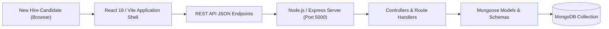

# 💼 Tamasha Candidate Onboarding Portal — Full-Stack MERN

<p align="center">
  
</p>

<p align="center">
  A full-stack MERN application built to streamline new hire verification, digital document submissions, and administrative HR reviews through a modern, responsive multi-step onboarding wizard.
</p>

<p align="center">
  <a href="https://github.com/prakruthidevanga/Tamasha_Onborading-">
    
  </a>
</p>

<p align="center">
  
  
  
  
</p>

---

## 📌 Table of Contents

- [📖 Project Overview](#-project-overview)
- [🎯 Objectives](#-objectives)
- [✨ Key Features](#-key-features)
- [🏗️ System Architecture & Workflow](#️-system-architecture--workflow)
- [🛠️ Technology Stack](#️-technology-stack)
- [📁 Repository Structure](#-repository-structure)
- [⚙️ Installation and Setup](#️-installation-and-setup)
- [🔮 Future Enhancements](#-future-enhancements)
- [🤝 Contributing](#-contributing)
- [👩‍💻 Author & Accreditations](#-author--accreditations)

---

## 📖 Project Overview

Enterprise employee onboarding often suffers from delays caused by fragmented email chains, physical paperwork verification, and manual data re-entry. Without a unified portal, candidates experience confusion regarding document status, and HR teams struggle to audit submission timelines.

The **Tamasha Candidate Onboarding Portal** delivers a modern, full-stack recruitment management solution. Candidates progress through a guided step-by-step form validating personal data, academic credentials, identity proofs, and bank details, while backend REST services store and index verification states in a structured **MongoDB** collection.

💼 **Core Mission:** Eliminate paper delays and deliver a friction-free onboarding journey for new hires.

---

## 🎯 Objectives

- 📝 **Multi-Step Onboarding Wizard:** Guide candidates through sequential profile completion with real-time field validation.
- ⚡ **RESTful Service Architecture:** Provide modular Express.js controllers and Mongoose data models.
- 🛡️ **Configuration Security:** Protect database credentials through strict `.env.example` templates and `.gitignore` rules.
- 📱 **Responsive Candidate Experience:** Deliver a fast, mobile-friendly interface built with **React 19** and **Vite**.

---

## ✨ Key Features

### 📋 1. Sequential Profile Wizard
Guided multi-phase form separating Personal Identity, Educational Background, Professional History, and Document Uploads.

### 🛡️ 2. Secure Backend API
Express router with modular controller separation, request validation, and clean error handling.

### 🗄️ 3. Mongoose Schema Validation
Strict typing for candidate records ensuring all mandatory compliance fields are validated before database commits.

---

## 🏗️ System Architecture & Workflow



---

## 🛠️ Technology Stack

<p align="center">
  
</p>

| Component | Technology | Implementation Details |
| :--- | :--- | :--- |
| **Frontend Framework** | React 19 & Vite | Fast client rendering, modular component hierarchy |
| **Backend Framework** | Node.js & Express.js | RESTful API endpoints and middleware pipelines |
| **Database ODM** | MongoDB & Mongoose | Flexible document schema modeling and validation |
| **Tooling & Linting** | Oxlint, Git | Code quality linting and version control |

---

## 📁 Repository Structure

```text
Tamasha_Onborading-/
├── backend/
│   ├── config/               # Database connection configuration (db.js)
│   ├── controllers/          # Request handlers and business logic
│   ├── models/               # Mongoose candidate models
│   ├── routes/               # Express API endpoints
│   ├── server.js             # Backend server entry point
│   ├── package.json          # Backend dependencies
│   └── .env.example          # Sanitized environment template
├── src/                      # React frontend source
│   ├── components/           # Wizard form steps and UI controls
│   ├── App.jsx               # Application orchestrator
│   └── main.jsx              # Client entry point
├── package.json              # Frontend dependencies
├── vite.config.js            # Vite configuration
└── README.md                 # Project documentation
```

---

## ⚙️ Installation and Setup

### Prerequisites
- Node.js (v18+)
- MongoDB Community Server running locally or MongoDB Atlas instance

### Step 1: Set Up Backend
```bash
cd backend
npm install
cp .env.example .env
npm start
```
*Backend server listens on `http://localhost:5000`.*

### Step 2: Set Up Frontend
Open a separate terminal:
```bash
npm install
npm run dev
```
*Frontend opens on `http://localhost:5173`.*

---

## 🔮 Future Enhancements

- 📄 **Automated PDF Offer Generator:** Generate digitally signed appointment letters upon verification.
- 🔔 **Email & SMS Status Triggers:** Automated notifications updating candidates on background verification milestones.

---

## 🤝 Contributing

Contributions are welcomed! Feel free to open an issue or submit a pull request.

---

## 👩‍💻 Author & Accreditations

**Prakruthi B R**  
*BCA Student specializing in Artificial Intelligence & Machine Learning*  
*Alliance University, Bengaluru (CGPA: 9.60)*  
*GeeksforGeeks Campus Mantri (2026)*

- 💻 **GitHub:** [@prakruthidevanga](https://github.com/prakruthidevanga)
- 🔗 **LinkedIn:** [Prakruthi BR](https://linkedin.com/in/prakruthi-br)
- 🌐 **Portfolio:** [prakruthidevanga.github.io](https://prakruthidevanga.github.io/)
- 📬 **Email:** [prakruthibr2006@gmail.com](mailto:prakruthibr2006@gmail.com)

---

<p align="center">
  <b>💼 Simplifying recruitment and candidate verification through clean software engineering.</b>
</p>

<p align="center">
  
</p>
